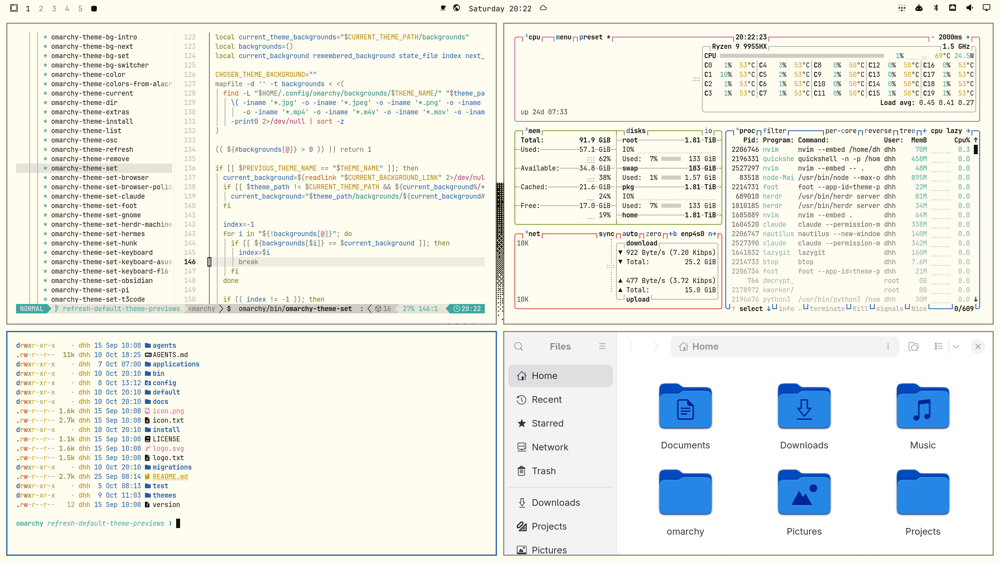

# Flexoki Altum

A light theme for Omarchy based on the Flexoki Light palette, with the Ristretto wallpaper and Yaru Blue icons.



## Installation

```sh
omarchy theme install https://github.com/harryxu/omarchy-flexoki-altum.git
```

Omarchy applies the theme after installation. To switch back to it later, run `omarchy theme set flexoki-altum`.

When installing from Git, Omarchy 4.5 skips the repository's `neovim.lua` and `vscode.json` and generates editor themes from `colors.toml`. [Omarchy theme documentation](https://omarchy.org/manual/making-your-own-theme/#what-an-installed-theme-can-contain)

## Local development

Clone the repository and link your checkout as `flexoki-altum-dev`. Both the development theme and the installed `flexoki-altum` theme can appear in the theme picker.

```sh
git clone https://github.com/harryxu/omarchy-flexoki-altum.git
cd omarchy-flexoki-altum
mkdir -p "$HOME/.config/omarchy/themes"
ln -sT "$PWD" "$HOME/.config/omarchy/themes/flexoki-altum-dev"
omarchy theme set flexoki-altum-dev
```

If you already have a checkout, open its root directory and start with the `mkdir` command.

Edit `colors.toml` to change the palette, or replace the wallpaper in `backgrounds/`. After each change, run `omarchy theme set flexoki-altum-dev` to reload the theme. [Palette](colors.toml) · [Wallpapers](backgrounds/)
